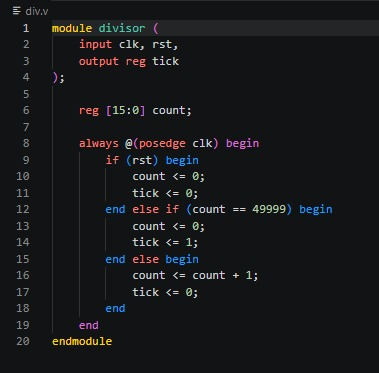
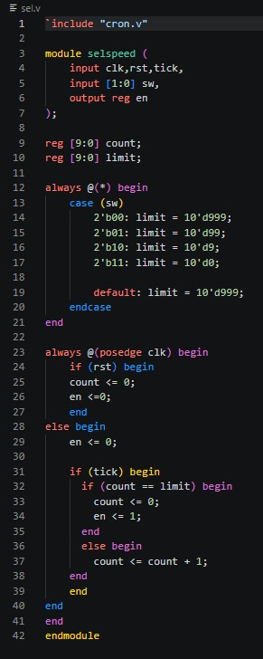
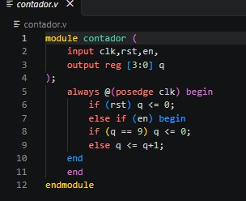
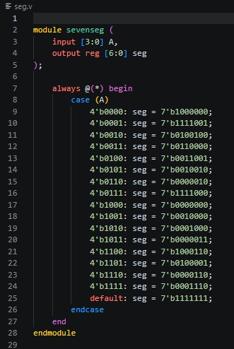
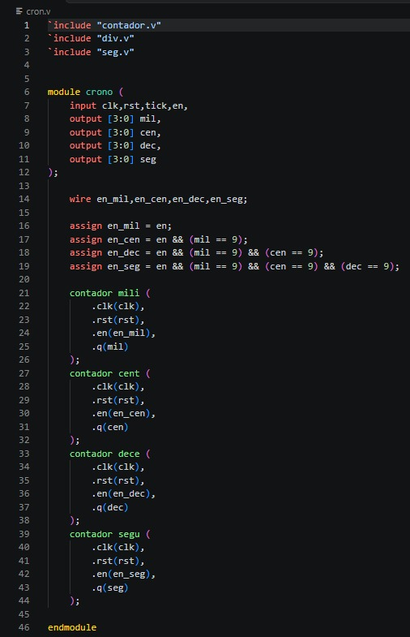

        
# Tecnicas Digitales D3E5

# Descripción
 Este es el repositorio de la asignatura tecnicas digitales.

# Integrantes
* [Gianfranco Lopez Seguin](https://github.com/PeruLover123)
* [Jesus David Leyton Ramirez](https://github.com/RagSource)
* [Heidy Carolina Calderon Romero](https://github.com/)
  
# Informe

Indice:

1. [Divisor de frecuencia](#Divisor-de-frecuencia)
2. [Selector](#Selector)
3. [Contador](#Contador)
4. [Decodificador](#Decodificador)
5. [Cronometro](#Cronometro)
6. [Evidencias de implementación](#evidencias-de-implementación)
7. [Conclusiones](#conclusiones)

## Documentación del diseño implementado

## 1. Divisor de frecuencia

#### 1.1 Descripción

Generar un pulso periódico de habilitación (tick) a partir del reloj principal (clk)

Funcionamiento:

Utiliza un contador interno de 16 bits (count) que se incrementa en cada flanco de subida de clk.   

Cuando count alcanza el valor 49999 (50,000 ciclos en total), reinicia el contador a 0 y genera un pulso tick = 1 que dura solo un ciclo de reloj. En los demás ciclos, tick permanece en 0.  

#### 1.2 Diagramas

## 2. Selector

#### 2.1 Descripción

Controlar el ritmo o frecuencia con la que avanza el cronómetro mediante un selector de entradas físicas (interruptores/switches).

Funcionamiento:

Lógica combinacional (always @(*)): Evalúa el valor del vector sw (2 bits) para asignar un límite de conteo (limit):   

  2'b00: limit = 999 (divide entre 1000 base de ticks).   
  
  2'b01: limit = 99 (divide entre 100 base de ticks). 
  
  2'b10: limit = 9 (divide entre 10 base de ticks).  
  
  2'b11: limit = 0 (avanza con cada tick directo).
  
Lógica secuencial (always @(posedge clk)): Cada vez que llega un tick proveniente del divisor: 
  
  Incrementa el contador interno count.  
  
  Cuando count alcanza el valor de limit, reinicia count a 0 y emite un pulso de habilitación   en = 1. En caso contrario, en se mantiene en 0.   

#### 2.2 Diagramas

## 3. Contador

#### 3.1 Descripción

Implementar un contador sincrónico módulo-10 (de 0 a 9).

Funcionamiento:

Si rst está activo, la salida q se fuerza a 0.   

Mientras la señal de habilitación (en) sea verdadera:  

Si q == 9, se reinicia a 0 (rollover).  

De lo contrario, se incrementa en 1 (q <= q + 1).   

Si en es 0, el contador conserva su valor actual.   

#### 3.2 Diagramas

## 4. Decodificador

#### 4.1 Descripción

Convertir un dato binario de 4 bits (A) a los bits de control para un display de 7 segmentos en configuración de Ánodo Común.

Funcionamiento:

Mediante un bloque case (A), mapea los dígitos decimales del 0 al 9 (y caracteres hexadecimales de 10 a 15) hacia la salida seg [6:0].  

 Al tratarse de lógica activa en bajo (ánodo común), un bit '0' enciende el segmento y un bit '1' lo apaga.

#### 4.2 Diagramas

## 5. Cronómetro

#### 5.1 Descripción

Integrar las etapas de conteo en cascada para representar un sistema multidígito (milisegundos, centésimas, décimas y segundos).

Funcionamiento:

Instancia cuatro estructuras del módulo contador.v: mili, cent, dece y segu.  

Cascada de Habilitación (Carry-Lookahead Logic):

en_mil: Recibe directamente el pulso en habilitador. 

en_cen: Se activa solo si en es activo Y mil == 9.  

en_dec: Se activa solo si en es activo Y mil == 9 Y cen == 9.  

en_seg: Se activa solo si en es activo Y mil == 9 Y cen == 9 Y dec == 9.   

#### 4.2 Diagramas

## Simulaciones

## Evidencias de implementación

[https://youtube.com/shorts/kCpCZXlP9Lc?feature=share](https://youtube.com/shorts/ld9kmHTvEUM?feature=share) 

## Conclusiones

En conclusión, el desarrollo de este proyecto permitió poner en práctica el diseño de sistemas digitales complejos mediante la modularización en HDL. La integración de un divisor de frecuencia y un selector de escala de tiempo (selspeed) demostró ser una estrategia eficiente para gestionar el flujo del reloj global de la FPGA hacia los contadores BCD en cascada. Asimismo, el correcto manejo de las señales de habilitación (en) garantizó que el incremento entre milisegundos, centésimas, décimas y segundos ocurriera de forma perfectamente sincrónica, facilitando una visualización precisa y estable en los displays de 7 segmentos.
