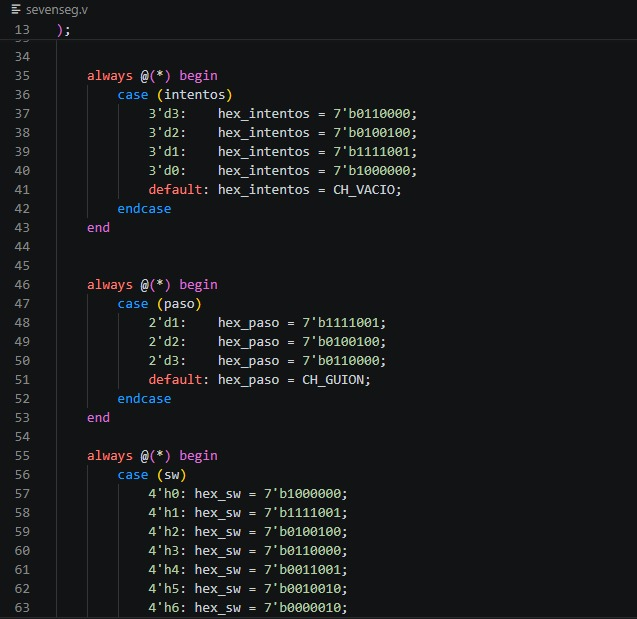
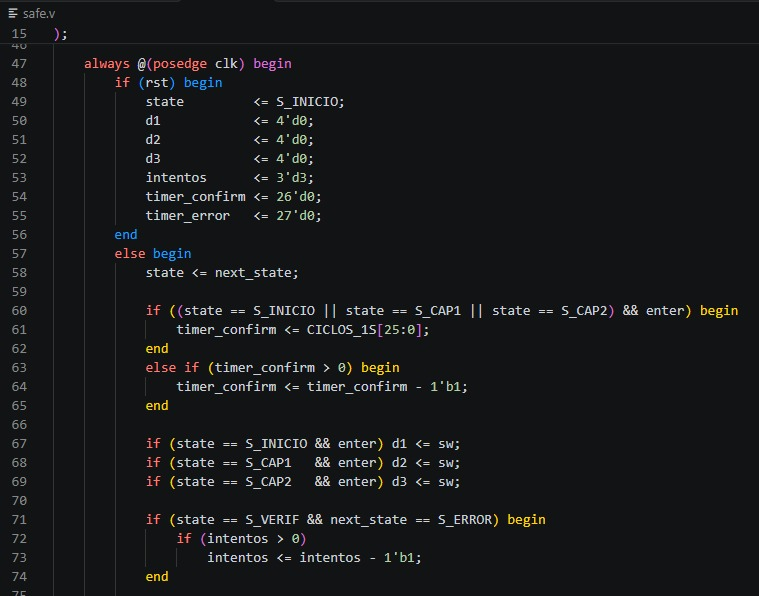
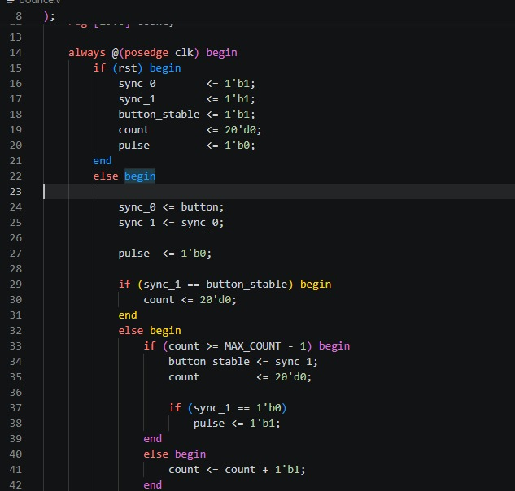
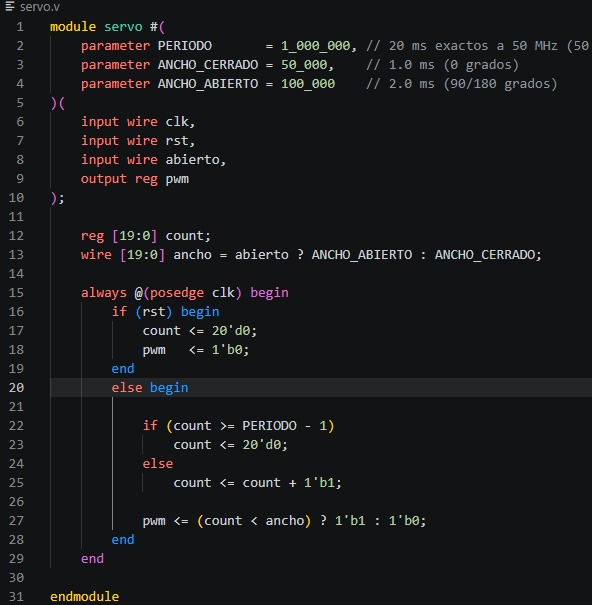

# Tecnicas Digitales D3E5

# Descripción
 Este es el repositorio de la asignatura tecnicas digitales.

# Integrantes
* [Gianfranco Lopez Seguin](https://github.com/PeruLover123)
* [Jesus David Leyton Ramirez](https://github.com/RagSource)
* [Heidy Carolina Calderon Romero](https://github.com/)
  
# Informe

Indice:

1. [Antirrebote (Debounce)](#Antirrebote-Debounce)
2. [Selector de Estados (FSM)](#Selector-de-Estados-FSM)
3. [Contador de Intentos y Dígitos](#Contador-de-Intentos-y-Digitos)
4. [Decodificador de Display y Servo](#Decodificador-de-Display-y-Servo)
5. [Caja Fuerte Digital](#Caja-Fuerte-Digital)
6. [Evidencias de implementación](#evidencias-de-implementación)
7. [Conclusiones](#conclusiones)

## Documentación del diseño implementado

## 1. Antirrebote (Debounce)

#### 1.1 Descripción

Estabilizar la señal del botón físico KEY0 (Enter) para evitar múltiples detecciones de un solo pulso debido al rebote mecánico de los contactos.

Funcionamiento:

Utiliza un contador interno de **20 bits** (`reg [19:0] count`) que se incrementa con el reloj de 50 MHz.
El sistema muestrea la entrada `button` en dos registros consecutivos (`sync_0`, `sync_1`) para sincronizarla con el dominio del reloj.

Si la señal se mantiene estable (igual a `button_stable`) durante un tiempo determinado (`MAX_COUNT`), se considera válida. Solo cuando se detecta un flanco de bajada confirmado (transición de estable a inestable tras contar), se genera un pulso único `pulse = 1'b1` que dura exactamente un ciclo de reloj, actuando como el "Enter" limpio para la FSM.

#### 1.2 Diagramas

## 2. Selector de Estados (FSM)

#### 2.1 Descripción

Controlar la secuencia lógica de la caja fuerte mediante una Máquina de Estado Finito (FSM) tipo Moore de 7 estados, donde las transiciones dependen de entradas del usuario (botón Enter, switches) y no del tiempo.

Funcionamiento:

Lógica secuencial (`always @(posedge clk)`): Gestiona el registro de estado (`state`) y los registros de datos (`d1`, `d2`, `d3`, `intentos`).

  **Captura:** En estados S_INICIO, S_CAP1 y S_CAP2, al recibir `enter`, se guardan los valores de los switches (`sw`) en los registros de dígitos correspondientes.
  
  **Verificación:** En S_VERIF, se compara la secuencia `{d1, d2, d3}` con la clave secreta definida por `localparam`.
  
  **Gestión de Intentos:** Si la clave es incorrecta, se decrementa el registro `intentos`. Si `intentos` llega a 0, se transita a S_BLOQUEO. Si hay intentos restantes, regresa a S_INICIO.

#### 2.2 Diagramas

## 3. Contador de Intentos y Dígitos

#### 3.1 Descripción

Almacenar temporalmente la combinación ingresada y llevar la cuenta regresiva de oportunidades restantes antes del bloqueo definitivo.

Funcionamiento:

Si `rst` está activo, `intentos` se inicializa en 3 y los dígitos en 0.

Mientras la FSM avanza:

Los dígitos (`d1`, `d2`, `d3`) se actualizan solo en el flanco de `enter` dentro de sus respectivos estados de captura.

El contador de `intentos` se decrementa (`intentos - 1'b1`) únicamente en la transición de S_VERIF a S_ERROR.

En S_BLOQUEO, el contador se congela y solo se reinicia mediante KEY1 (Master Reset).

#### 3.2 Diagramas

## 4. Decodificador de Display y Servo

#### 4.1 Descripción

Traducir el estado interno y los datos numéricos a señales visuales (7 segmentos) y mecánicas (PWM para servo).

Funcionamiento:

**Display 7 Segmentos:** Mediante bloques `case` combinacionales, mapea:
- El número de intentos restantes a mensajes como "Int. n".
- El estado de progreso a guiones "---" o caracteres de eco.
- El estado final a "AccESO" o "bLOquE".

**Servomotor (PWM):** Genera una señal de 50 Hz (periodo de 20 ms) usando un contador de 20 bits (1,000,000 cuentas a 50 MHz).
- **Cerrado (0°):** Ancho de pulso de 1 ms (50,000 cuentas).
- **Abierto (90°):** Ancho de pulso de 2 ms (100,000 cuentas).
La salida `pwm` es alta mientras `count < ancho`, definiendo la posición del cerrojo.

#### 4.2 Diagramas

## 5. Caja Fuerte Digital

#### 5.1 Descripción

Integrar todos los módulos (Debounce, FSM, PWM, Display) para crear un sistema de seguridad funcional con realimentación visual y actuación física.

Funcionamiento:

Instancia los módulos `debounce`, `safe` (FSM principal) y `servo`.

Lógica de Interacción:

`pulse`: Señal limpia del botón que dispara la captura de dígitos.
`abierto`: Salida de la FSM que controla el parámetro `ANCHO` del módulo servo.
`hex_out`: Vector de 6 displays que muestra el estado actual del sistema al usuario.

Seguridad: La comparación de la clave se realiza exclusivamente en el estado S_VERIF, evitando revelar información parcial sobre qué dígito falló.

## Conclusiones

En conclusión, el desarrollo de este proyecto permitió consolidar el diseño de FSMs tipo Moore orientadas a eventos de usuario, diferenciándolas claramente de las basadas en tiempo. La implementación de un módulo de antirrebote (debounce) fue crítica para garantizar la fiabilidad de las entradas físicas, evitando transiciones espurias en la máquina de estados. Asimismo, la generación de señal PWM mediante contadores de 20 bits demostró ser una estrategia eficiente para controlar actuadores analógicos como el servomotor directamente desde lógica digital. Finalmente, la integración de mensajes dinámicos en los displays de 7 segmentos proporcionó una interfaz de usuario intuitiva que realimenta el estado de seguridad (intentos restantes, bloqueo) sin necesidad de equipos externos.
