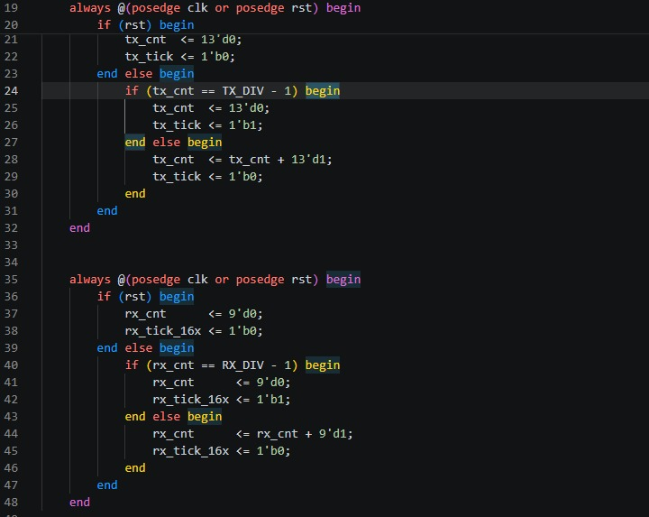
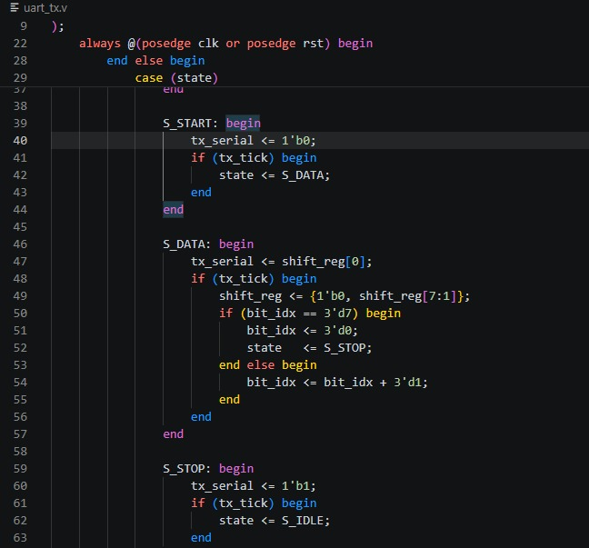
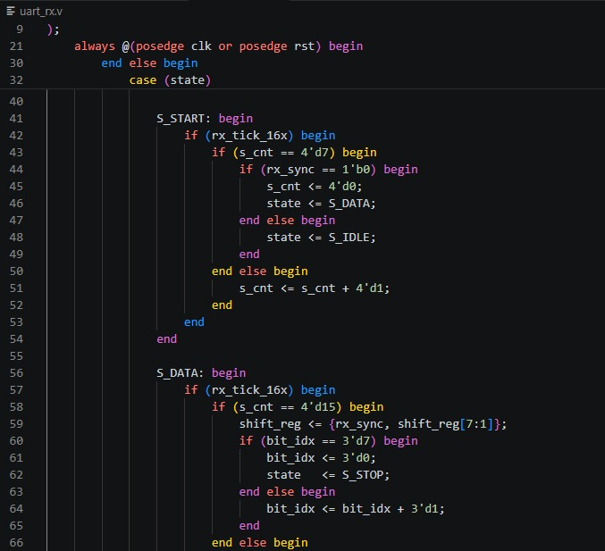
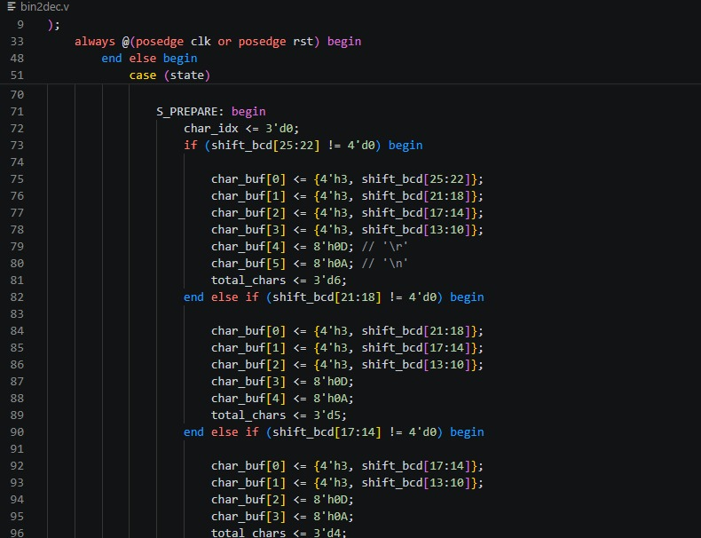
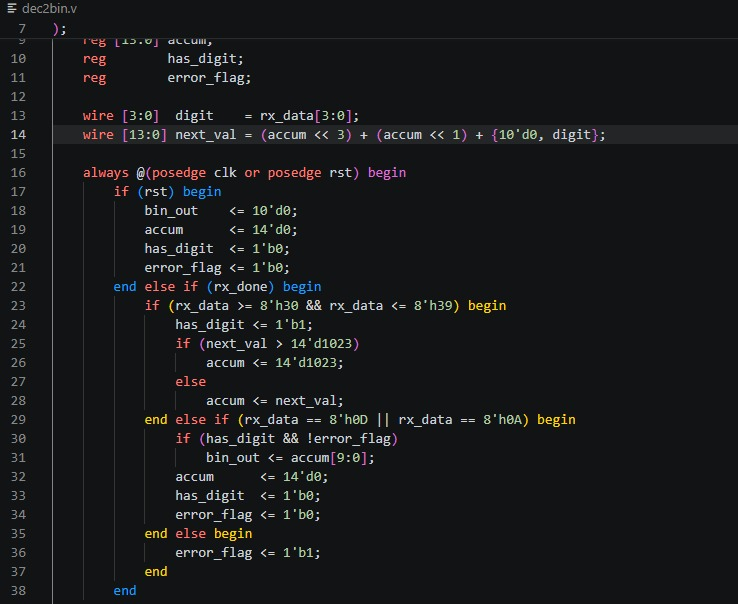
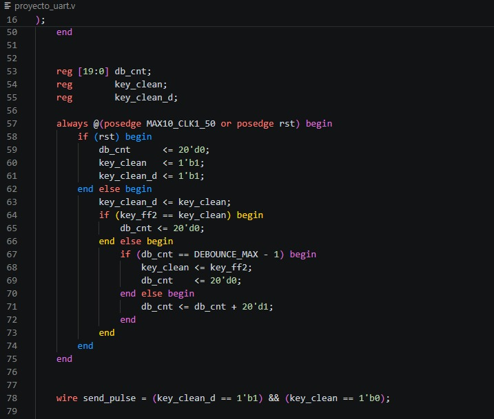

# Tecnicas Digitales D3E5

# Descripción
 Este es el repositorio de la asignatura tecnicas digitales.

# Integrantes
* [Gianfranco Lopez Seguin](https://github.com/PeruLover123)
* [Jesus David Leyton Ramirez](https://github.com/RagSource)
* [Heidy Carolina Calderon Romero](https://github.com/)
  
# Informe

Indice:

1. [Generador de Baudios](#Generador-de-Baudios)
2. [Transmisor UART (TX)](#Transmisor-UART-TX)
3. [Receptor UART (RX)](#Receptor-UART-RX)
4. [Conversores Binario-Decimal](#Conversores-Binario-Decimal)
5. [Sistema de Comunicación Bidireccional](#Sistema-de-Comunicación-Bidireccional)
6. [Evidencias de implementación](#evidencias-de-implementación)
7. [Conclusiones](#conclusiones)

## Documentación del diseño implementado

## 1. Generador de Baudios

#### 1.1 Descripción

Generar una señal de habilitación (`baud_tick`) precisa para sincronizar la transmisión y recepción serial a 9600 baudios.

Funcionamiento:

Utiliza un contador interno que se incrementa con el reloj principal de **50 MHz**.
Para obtener 9600 baudios, se calcula el divisor: $50,000,000 / 9600 \approx 5208$.
El contador cuenta hasta **5207** (5208 ciclos totales), momento en el cual reinicia a 0 y genera un pulso `baud_tick = 1` durante un solo ciclo de reloj. Este pulso actúa como el "reloj virtual" para las FSMs de TX y RX.

#### 1.2 Diagramas

## 2. Transmisor UART (TX)

#### 2.1 Descripción

Serializar datos provenientes de la FPGA hacia el PC. Convierte un valor numérico de 10 bits (switches) a caracteres ASCII y los envía bit a bit.

Funcionamiento:

Implementa una FSM tipo Moore que gestiona el protocolo 8-N-1 (1 Start, 8 Datos, 1 Stop).
Al recibir la señal de disparo (`send_cmd`), la máquina transita por los siguientes estados:
- **IDLE:** Línea TX en alto (reposo). Espera comando.
- **START:** Baja la línea TX (bit de start) durante 1 ciclo de baudios.
- **DATA_0 a DATA_7:** Envía los 8 bits del carácter ASCII actual, comenzando por el LSB (Least Significant Bit).
- **STOP:** Sube la línea TX (bit de stop) durante 1 ciclo.
- **NEXT_CHAR:** Verifica si quedan más dígitos decimales por enviar. Si sí, carga el siguiente dígito y vuelve a START. Si no, retorna a IDLE.

#### 2.2 Diagramas

## 3. Receptor UART (RX)

#### 3.1 Descripción

Deserializar datos entrantes desde el PC hacia la FPGA. Detecta tramas UART, reconstruye bytes y valida integridad.

Funcionamiento:

La FSM espera en IDLE monitoreando la línea RX. Al detectar un flanco de bajada (Start bit), inicia el conteo.
Para garantizar robustez, utiliza **sobremuestreo**: espera medio ciclo de baudios tras detectar el start para muestrear el centro exacto de cada bit de datos, evitando errores por ruido o desincronización leve.
Reconstruye el byte recibiendo LSB primero. Al finalizar los 8 bits, verifica el bit de Stop; si es '0', marca un **Framing Error** y descarta el dato. Si es válido, almacena el byte en un buffer para el conversor decimal.

#### 3.2 Diagramas

## 4. Conversores Binario-Decimal

#### 4.1 Descripción

Resolver la discrepancia entre el ancho de bus UART (8 bits) y el rango de datos del sistema (10 bits, 0-1023) mediante conversión a texto ASCII.

Funcionamiento:

**Binario a Decimal (TX - `bin2dec.v`):**
Toma el valor de 10 bits de los switches y lo divide sucesivamente por 10 para extraer los dígitos decimales (Unidades, Decenas, Centenas, Miles). Cada dígito se suma con `8'h30` (código ASCII para '0') antes de ser enviado al módulo TX.

**Decimal a Binario (RX - `dec2bin.v`):**
Acumula los caracteres ASCII recibidos usando la lógica posicional: `valor_acumulado = (valor_anterior * 10) + (caracter_recibido - '0')`.
El proceso termina al recibir el carácter de salto de línea (Enter, 0x0A), momento en el cual el valor binario resultante se transfiere a los LEDs.

#### 4.2 Diagramas

## 5. Sistema de Comunicación Bidireccional

#### 5.1 Descripción

Integrar todos los módulos en un top-level (`proyecto_uart.v`) que gestione el flujo de datos bidireccional entre la DE10-Lite y PuTTY.

Funcionamiento:

Instancia los módulos `uart_tx`, `uart_rx`, `baud_gen`, `bin2dec` y `dec2bin`.

Lógica de Control:
- **Botón KEY0:** Se sincroniza y detecta su flanco para generar un único pulso `send_cmd` que inicia la transmisión del valor actual de los switches.
- **Sincronización:** Las entradas asíncronas (RX y KEY0) pasan por dobletes de flip-flops para evitar metaestabilidad.
- **Visualización:** Los 10 LEDs (`LEDR9..LEDR0`) muestran directamente el registro de salida del módulo `dec2bin`, representando en binario puro el número escrito en la terminal.

#### 5.2 Diagramas

## Evidencias de implementación

[https://youtube.com/shorts/kCpCZXlP9Lc?feature=share](https://youtube.com/shorts/ld9kmHTvEUM?feature=share) 

## Conclusiones

En conclusión, este proyecto demostró la viabilidad de implementar protocolos de comunicación estándar completamente en lógica programable. La separación modular entre la capa física (UART TX/RX) y la capa de aplicación (conversores binario-decimal) permitió depurar independientemente la temporización de los baudios y la lógica aritmética. Un hallazgo clave fue la necesidad de convertir los datos a ASCII para superar la limitación de 8 bits del protocolo UART básico, permitiendo transmitir rangos de 10 bits (0-1023) de forma legible. Asimismo, la implementación de sobremuestreo en el receptor y la detección de flancos en el botón de transmisión fueron críticas para garantizar una comunicación robusta y libre de rebotes o falsos disparos en un entorno real con ruido eléctrico.
